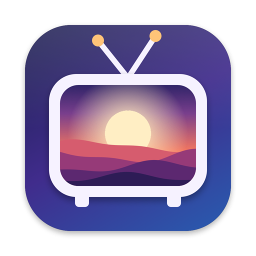
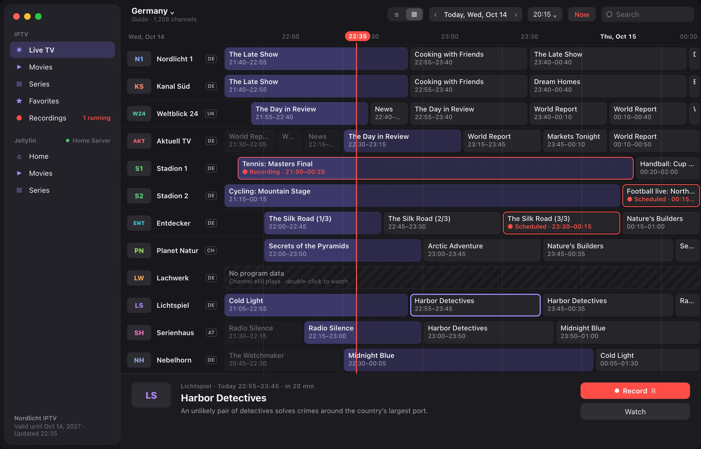
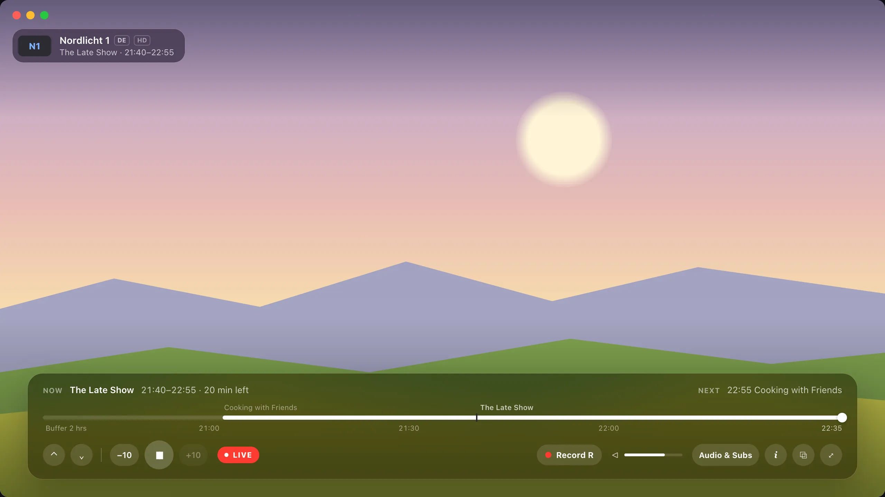
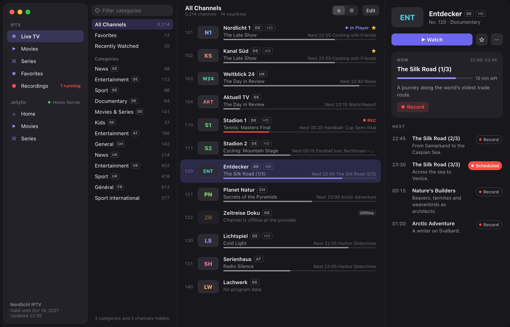
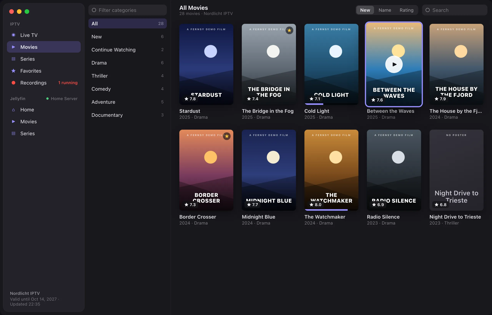
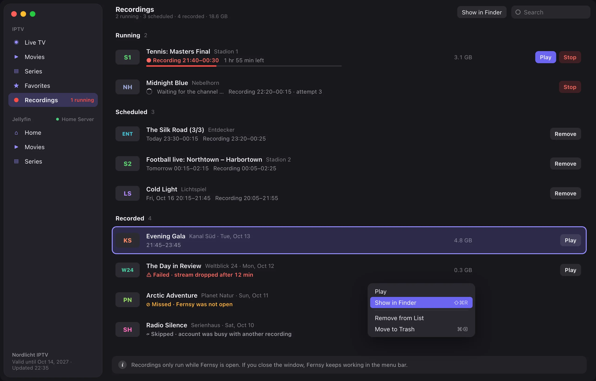
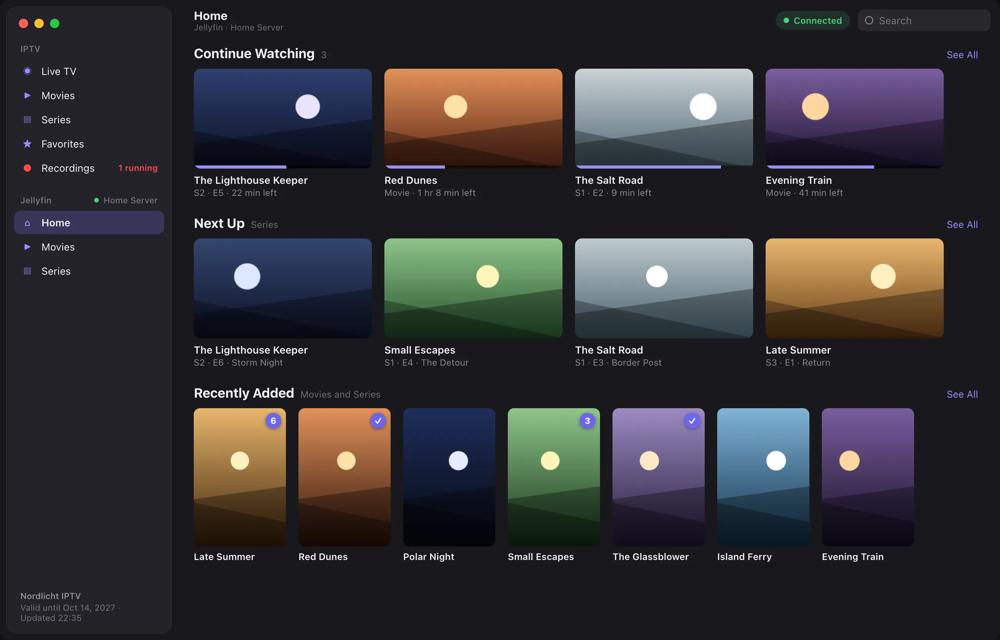

<p align="center">
  
</p>

<h1 align="center">Fernsy</h1>

<p align="center">
  <strong>Your IPTV subscription as a real Mac app.</strong><br>
  Live TV with a program guide, movies and series – fast, native and ad-free.<br>
  For Xtream Codes accounts.
</p>

<p align="center">
  <a href="https://github.com/obi12341/fernsy/releases/latest/download/Fernsy.dmg"><strong>Download for Mac</strong></a>
  ·
  <a href="https://www.fernsy.app/en/">Website</a>
  ·
  <a href="https://www.fernsy.app/">Deutsch</a>
</p>

<p align="center">
  For Macs with Apple silicon · macOS 27 or later · Coming soon to the Mac App Store
</p>



## Made for the Mac

Fernsy is not a web player in a window. It is a native macOS app that feels at home on your
Mac: hardware decoding, keyboard control and the system's dark and light appearance. Sign in with your provider's Xtream Codes account and your channels,
movies and series are there.



### Live TV

- Channel list with categories, search and favorites
- Program guide for all channels
- Switch channels with the arrow keys
- What is on now and next, right in the list



### Movies and series

- Poster view, sorted by newest, name or rating
- Seasons and episodes
- Continue where you left off



### Playback

- Hardware decoding, up to 4K
- Deinterlacing on the GPU
- Seamless reconnects on network dropouts

## Record, rewind and your own media library

### Recordings

Record shows without missing a thing. Record right from the channel list, the program guide
or the player. Fernsy keeps working in the menu bar, even when the window is closed.

- Adjustable padding before and after
- Play while still recording
- Running, scheduled and recorded in one list
- Clear notes on failed or missed recordings



### Jellyfin

Your own media server, right next to your IPTV account. Connect your Jellyfin server as well.
Both accounts are active at the same time and appear separately in the sidebar, with the same
controls.

- Continue Watching, Next Up and Recently Added on one home page
- Libraries and genres as categories
- Watched status, unwatched episodes and favorites
- The library stays visible when the server is offline



### And more

- **Timeshift.** Pause live TV and rewind up to two hours. One click takes you back to live.
- **Picture in Picture.** Keep watching while you work on your Mac. Switching channels works
  in the small window, too.
- **One search for everything.** Channels, movies, series, recordings and Jellyfin in one
  search field, sorted by source.
- **Menu bar.** Running and upcoming recordings at a glance, even without an open window.

## Privacy

Fernsy collects no data. Your credentials stay in your Mac's keychain, and the app only
connects to your provider.

## Get Fernsy

Download [Fernsy.dmg](https://github.com/obi12341/fernsy/releases/latest/download/Fernsy.dmg),
open it and drag Fernsy into your Applications folder. The download is signed and notarized by
Apple, and Fernsy updates itself. Fernsy is coming soon to the Mac App Store.

Requires a Mac with Apple silicon and macOS 27 or later.

> **Important:** Fernsy contains no channels, movies or other content and sells no
> subscriptions. You need an account (Xtream Codes API) with an IPTV provider of your choice.

Questions or problems? See [Support](https://www.fernsy.app/en/support.html).

---

## Contributing

Fernsy is free software by mobilistics GmbH under the
[GNU General Public License v3](LICENSE) or later. The bundled FFmpeg libraries are licensed
separately under the LGPL 2.1 or later.

Bug reports and ideas are welcome as [issues](https://github.com/obi12341/fernsy/issues).
Fernsy is also sold through the Mac App Store, whose terms are not compatible with the GPL for
third-party code, so pull requests can only be accepted together with a contributor license
agreement that allows this.

To build it yourself (Xcode 27 with its Metal toolchain, Apple silicon):

```sh
scripts/build-ffmpeg.sh    # builds LGPL FFmpeg into Vendor/ffmpeg, once
open Fernsy.xcodeproj
```

Everything else – releases, update signing, the demo server and the debug switches – is in
[DEVELOPMENT.md](DEVELOPMENT.md).
